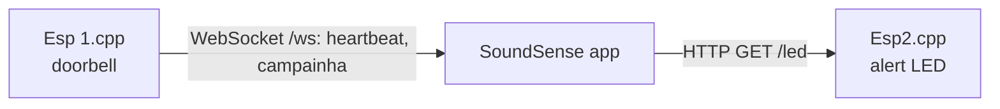

# SoundSense ESP32 firmware

Firmware for the two ESP32 boards of [SoundSense](https://github.com/viniciusbregoli/sound-sense), an IoT system that lets deaf users notice sound-emitting devices at home. The phone app in that repo sits between the two boards.



## Boards

- **`src/Esp 1.cpp`, doorbell**: connects to Wi-Fi and runs a WebSocket server on port 80 at `/ws`. It sends `heartbeat` to every client once per second and sends `campainha` when GPIO 2 reads high. GPIO 2 is set as an output and driven high in `setup()`, and `campainhaAtivada` is never reset, so as written `campainha` is sent once per boot, on the first loop after Wi-Fi connects, not on a button press.
- **`src/Esp2.cpp`, alert**: connects to Wi-Fi and runs an HTTP server on port 80. `GET /led` turns on the LED on GPIO 2 and answers `LED ligado`.

Both boards print their IP address on the serial monitor (9600 baud) after connecting. The app needs those addresses in its `lib/devices.dart`.

## Building

This is a PlatformIO project for the `esp32dev` board with the Arduino framework and `ESPAsyncWebServer-esphome`.

1. Set `ssid` and `password` at the top of the sketch to your Wi-Fi network.
2. Both sketches define `setup()` and `loop()`, so keep only the one you are flashing in `src/`.
3. Build and upload:

```
pio run -t upload
pio device monitor -b 9600
```
